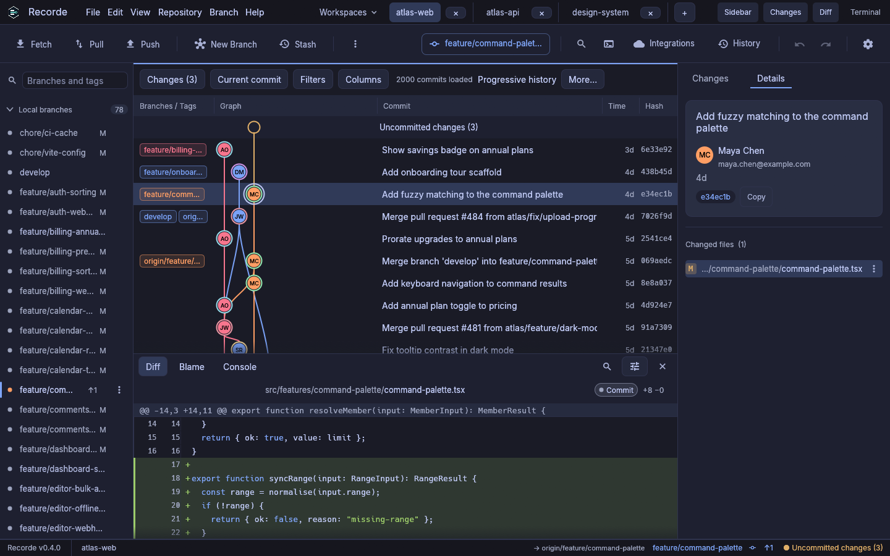
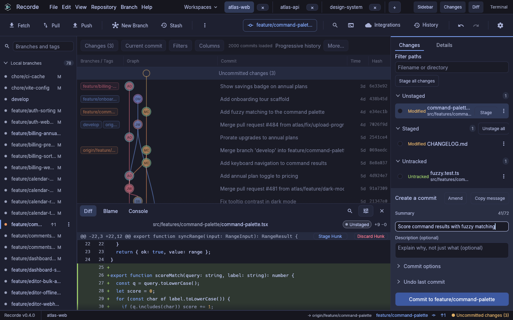
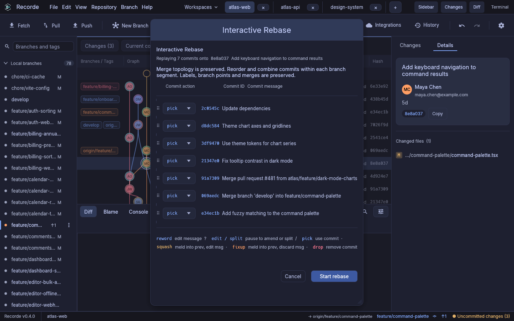
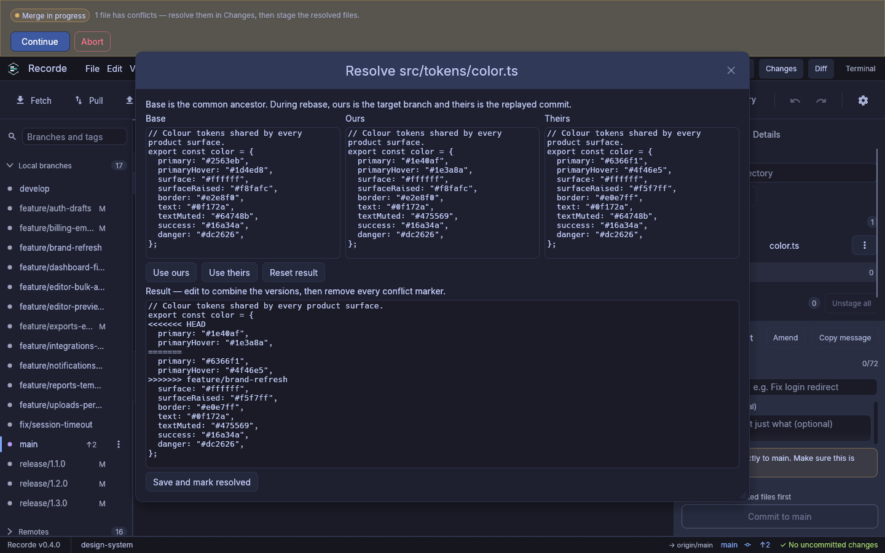
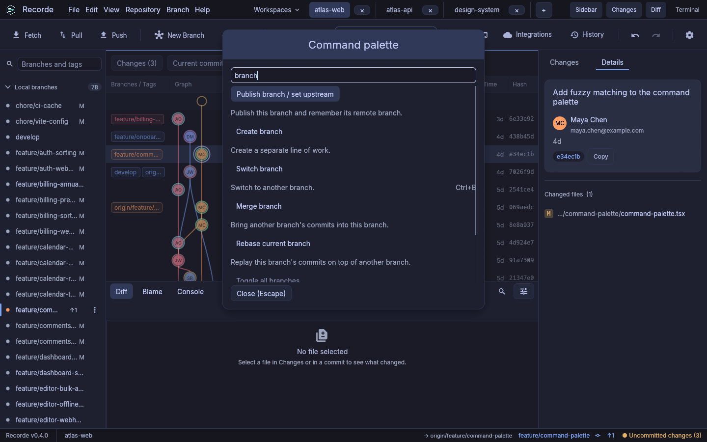
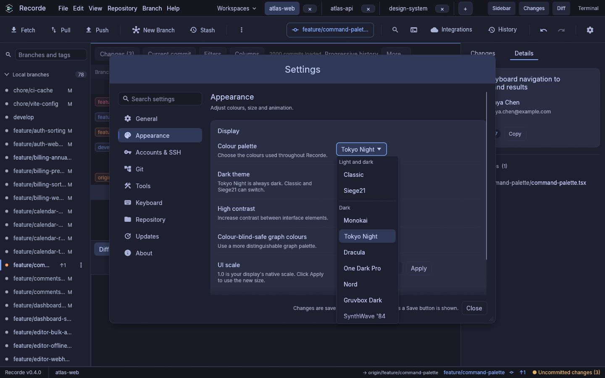

# Recorde

**A calm, fast Git client for Windows, Linux and macOS.**

Recorde gives you a clear picture of your repository and the tools to change it
with confidence. It's built in Rust, so it stays quick on very large
repositories, and it's free and open source.



[Download](#download) · [Features](#features) · [Documentation](docs/wiki/Home.md) · [What's new in 0.5.0](docs/release-notes/0.5.0.md)

---

## See your history clearly

The commit graph shows every branch splitting off and merging back in. Each
commit is shown as its author's initials in the branch colour, outlined in a
colour that's unique to that person, so you can follow a branch and a teammate
through the history at a glance. History loads in pages, so even repositories
with 100,000 commits open quickly.

## Commit exactly what you mean



Stage whole files, single hunks or individual lines, and see exactly what will
change before you commit. Amend, add co-authors and sign commits from the same
panel.

## Rewrite history without fear



Interactive rebase lets you reorder, reword, squash, fix up, drop or split
commits from a simple list. Cherry-pick and rebase by dragging commits in the
graph. Supported local operations can be undone: recovery snapshots let you
step back, and forward again.

## Resolve conflicts in one place



The built-in conflict editor shows the original, your version and theirs side by
side, with an editable result below. Take one side in a click, combine them by
hand, or open your own merge tool.

## Everything is a keystroke away



Press **Ctrl+K** (**Cmd+K** on macOS) to find any command, and set your own
keyboard shortcuts for the ones you use most.

## Make it yours



Choose from twelve themes: Classic and Siege21 in light and dark, plus Monokai,
Tokyo Night, Dracula, One Dark Pro, Nord, Gruvbox Dark, SynthWave '84, GitHub
Light, Solarized Light and Catppuccin Latte. Every theme is tuned for readable
contrast. High-contrast mode, colour-blind-safe graph colours, text scaling,
reduced motion and screen-reader support are built in.

---

## Features

**History and review**
- Paged commit graph with branch lanes, author nodes and configurable columns
- Commit details, file history, blame and two-commit comparison
- Commit and branch search, reflog recovery and guided bisect

**Staging and committing**
- Stage, unstage or discard files, hunks or individual lines
- Diff context, whitespace and full-file options
- Amend, co-authors, signed commits and Git hook output
- Built-in text editor and patch import and export

**Branches, tags and merging**
- Create, switch, rename, publish, delete and restore branches
- Safe switching that brings your changes along or stashes them for later
- Fast-forward, merge commit, fast-forward-only and squash merges
- Annotated tags and Git Flow for features, releases and hotfixes

**Advanced history editing**
- Interactive rebase: reorder, reword, squash, fixup, drop, edit and split
- Drag-to-cherry-pick, revert, rebase and multi-commit drop, with a preview first
- Soft, mixed and hard reset
- Undo and Redo backed by recovery snapshots you can browse, pin and restore

**Conflicts**
- Merge, rebase, cherry-pick, revert and bisect awareness
- Three-way conflict editor with saved drafts, or your own merge tool
- Continue, skip or abort any operation in progress

**Remotes and providers**
- Fetch, pull (merge, rebase or fast-forward only), push and push with lease
- Browser sign-in for GitHub and GitLab, with tokens kept in your system's
  secure storage
- Pull or merge requests, issues, CI runs and releases for GitHub, GitLab,
  Bitbucket Cloud and Azure DevOps
- Browse, search, clone and fork repositories

**Repository tools**
- Stashes, submodules, linked worktrees and sparse checkout
- Git LFS detection and full-history fetch for shallow clones
- Workspaces and tabs for several repositories at once

**Identity and tools**
- Profiles with commit identity, signing key and per-host accounts
- SSH key generation, diagnostics and copying
- Command tabs, plus your own terminal, editor, diff and merge tools
- Searchable offline help

## Download

Get the latest version from the
[Releases page](https://github.com/antonydoyle/Recorde/releases).

| Platform | Packages |
| --- | --- |
| Windows (x64) | MSI installer or portable zip |
| Linux (x86_64) | `.deb`, AppImage or portable tar.gz |
| macOS (Apple silicon and Intel) | `.dmg` or portable tar.gz |

Recorde can check for updates (turn it on in Settings › Updates) and verifies
their signatures before installing them.

**Before you start:** Recorde uses your installed [Git](https://git-scm.com/)
for some operations, so make sure `git` is on your PATH. On Windows, you also
need the
[Microsoft Visual C++ Redistributable](https://learn.microsoft.com/en-us/cpp/windows/latest-supported-vc-redist/).
Windows builds aren't Authenticode-signed and macOS builds aren't notarized yet,
so your system may ask you to confirm the first launch.

## Build from source

You'll need Rust 1.95 or newer and the native libraries for your platform (see
the [Developer Guide](docs/wiki/Developer-Guide.md)).

```bash
git clone https://github.com/antonydoyle/Recorde.git
cd Recorde
cargo build --release
```

The app is built to `target/release/recorde`. To enable GitHub and GitLab
browser sign-in in your own build, register an OAuth app and follow
[Browser sign-in](docs/browser-sign-in.md); signing in with a personal access
token works in any build.

## Documentation

- [User Guide](docs/wiki/User-Guide.md): everyday workflows
- [Feature Reference](docs/wiki/Feature-Reference.md): everything Recorde can do
- [Themes and accessibility](docs/wiki/Themes-and-Accessibility.md)
- [Architecture](docs/wiki/Architecture.md) and
  [Developer Guide](docs/wiki/Developer-Guide.md): how it's built and tested
- [Packaging](docs/wiki/Packaging.md): installers, updates and releases

## Licence

Recorde is free and open source under the [MIT licence](LICENSE).
